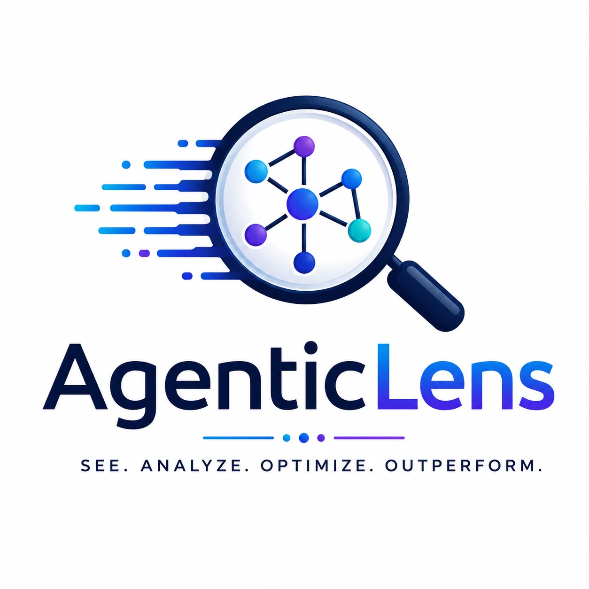

# AgenticLens

{ width="420" }

**Open-source observability, evaluation, and operational intelligence for
production AI systems.**

[](https://github.com/DeepAgentLabs/agenticlens/actions/workflows/ci.yml)
[](https://pypi.org/project/agenticlens/)
[](https://github.com/DeepAgentLabs/agenticlens/stargazers)
[](https://pepy.tech/project/agenticlens)

AgenticLens helps teams profile LLM applications, capture structured agent
traces, calculate cost, diagnose memory and retry overhead, and compare
candidate configurations against reviewed baselines.


## Optimization intelligence — 0.11.0

Roadmap v0.9 is implemented: `agenticlens optimize` turns recorded traces into
ranked, evidence-backed recommendations for prompt caching and compression,
retrieval pruning and reranking, memory summarization, tool caching, retry
policy, redundant steps, unnecessary handoffs, and quality-cost trade-offs
between variants. Projected benefit, confidence, and quality risk are separate
fields; decisions are tracked in a local ledger; and adopted changes are
evaluated against traces recorded afterwards, with projected and observed
outcomes reported side by side.

```bash
uv run python examples/optimization_demo.py
agenticlens optimize analyze examples/optimization/traces/before \
  --config examples/optimization/optimization.yaml --baseline-variant large
```

Recommendations are advisory and never change prompts, models, or tools. See
the [optimization guide](optimization.md) for the signals each rule reads, ledger
transitions, outcome statuses, and known limits.

## Advisory runtime routing — 0.10.0

Roadmap v0.8 is implemented: `agenticlens.routing.Router` turns saved ModelFit
experiment evidence into explainable runtime decisions, with additional hard
constraints, confidence thresholds, bounded fallback/provider failover, human
escalation handoffs, shadow/canary modes and a local audit journal. Advisory is
the default; execution requires explicit modes and caller-owned callbacks.

```bash
uv run python examples/routing_demo.py
agenticlens routing decide examples/modelfit/artifacts/modelfit.json \
  --category orders --request-id demo-1 \
  --policy examples/routing/artifacts/policy.json
```

The offline demo explicitly permits low confidence; default policies require
medium confidence. See the [routing guide](routing.md) for execution boundaries,
measurement, audit limits and sibling compatibility. Next: roadmap v0.9
Optimization Intelligence.

## What It Measures

| Dimension | What AgenticLens captures |
| --- | --- |
| Step token use | Prompt tokens, completion tokens, total tokens by workflow step |
| Cost | Provider pricing, dollar-per-run, monthly projections |
| Latency | Step-level runtime and tokens per second |
| Workflow shape | Planner, retriever, tool, memory, and final-response steps |
| Waste patterns | Repeated prompts, excessive chunks, duplicate tool calls, long history |
| Quality risk | Confidence and risk notes for optimization recommendations |
| Resilience | Fault-injection outcomes through the `chaos_events` schema extension |
| Tracing | Hierarchical runs and spans with status and error evidence |
| Comparison | Success, tokens, latency, cost, variability, and regression deltas |
| Diagnosis | Failure taxonomy, faulty step and agent, incident timeline, baseline anomalies |
| Evaluation quality | Deterministic vs model-based scores, judge cost, evaluator disagreement |
| Regression suites | Cases from CSV/JSON, traces, and feedback; PII masking, duplicates, splits, approved immutable versions |
| Model selection | Per-task-category recommendations under hard constraints, with confidence, fallbacks, savings, and quality risks |

## Token Optimization Focus

AgenticLens reports token savings at the step where the waste occurs:

| Area | Optimization signal |
| --- | --- |
| Prompting | Repeated prompt prefixes that should be cached or deduplicated |
| RAG | Excessive top-k retrieval and low-utility retrieved chunks |
| Memory | Conversation history that should be summarized or truncated |
| Tools | Duplicate tool calls that should be cached |
| Multi-agent handoffs | Oversized context passed between agents |
| Workflow | Estimated reducible tokens, cost per run, and monthly savings |

Multi-agent workflows can attach `agent_name`, `agent_role`, and handoff metadata
to each step. AgenticLens then reports token usage by agent and flags oversized
handoffs that should be summarized before passing context to the next agent.

## Why It Matters

Production agent systems fail in ways that ordinary request logs rarely explain.
Token cost can drift across memory, retrieval, planning, and tool use. Reliability
can degrade silently when an upstream tool fails. AgenticLens keeps these signals
local, inspectable, and exportable so teams can compare workflows across versions.

## Documentation

- [Getting started](getting-started.md)
- [Architecture](architecture.md)
- [Features](features.md)
- [Configuration](configuration.md)
- [API reference](api-reference.md)
- [CLI reference](cli-reference.md)
- [Integrations](integrations.md)
- [Examples](examples.md)
- [Workflow schema specification](workflow-schema-spec.md)
- [AIOS v0.6 examples and extensions](aios-v0.6.md)
- [AIOS v0.6.1 provenance and conformance suite](aios-0.6.1.md)
- [AIOS validation and OTel export](aios-validation-and-otel.md)
- [Export formats](export-formats.md)
- [RAG chunk utility](rag-chunk-utility.md)
- [Trace and comparison](trace-and-comparison.md)
- [Evaluation and release gates](evaluation-and-release-gates.md)
- [Test-suite and dataset management](suite-management.md)
- [Diagnosis and failure attribution](diagnosis.md)
- [Experiments and statistical comparison](experiments.md)
- [ModelFit recommendations](modelfit.md)
- [Multi-agent reference workflows](multi-agent-reference-workflows.md)
- [Troubleshooting](troubleshooting.md)
- [Limitations](limitations.md)
- [Roadmap](roadmap.md)
- [Product roadmap](https://github.com/DeepAgentLabs/agenticlens/blob/main/agenticlens-roadmap.md)
- [Research roadmap](https://github.com/DeepAgentLabs/agenticlens/blob/main/AgenticLens_Research_and_Development_Roadmap.md)

## Quickstart

```python
from agenticlens import profile, step

with profile("Customer Support"):
    with step("Planner", type="planner") as s:
        response = planner_llm.invoke(prompt)
        s.record(response)
```

```bash
uv run agenticlens profile examples/recommendations_demo.py --save workflow.json
uv run agenticlens analyze workflow.json
```

## Current Status

**Version:** 0.7.0 · **PyPI:** [`agenticlens`](https://pypi.org/project/agenticlens/) · **Maturity:** Alpha

AgenticLens is early-stage open-source software. Workflow profiling, live and
offline pricing, optimization recommendations, structured tracing, deterministic
memory and retry findings, repeated-run comparison, evaluation suites with
versioned evaluators and evidence audits, release gates with webhook alerts,
judge calibration, multi-variant experiments with pass@k and significance
tests, failure diagnosis with faulty-step attribution and incident timelines,
trace-aware evaluators, judge cost and evaluator-disagreement reporting, AIOS
draft validation/conformance with rule-cited summaries, OTLP trace export and ingestion, HTML
dashboards, CLI commands, and export formats are implemented. The trace,
comparison, evaluation, and experiment APIs remain experimental. Framework
adapters remain roadmap work.

See [Limitations](limitations.md) for known constraints and [Roadmap](roadmap.md)
for planned capabilities.
