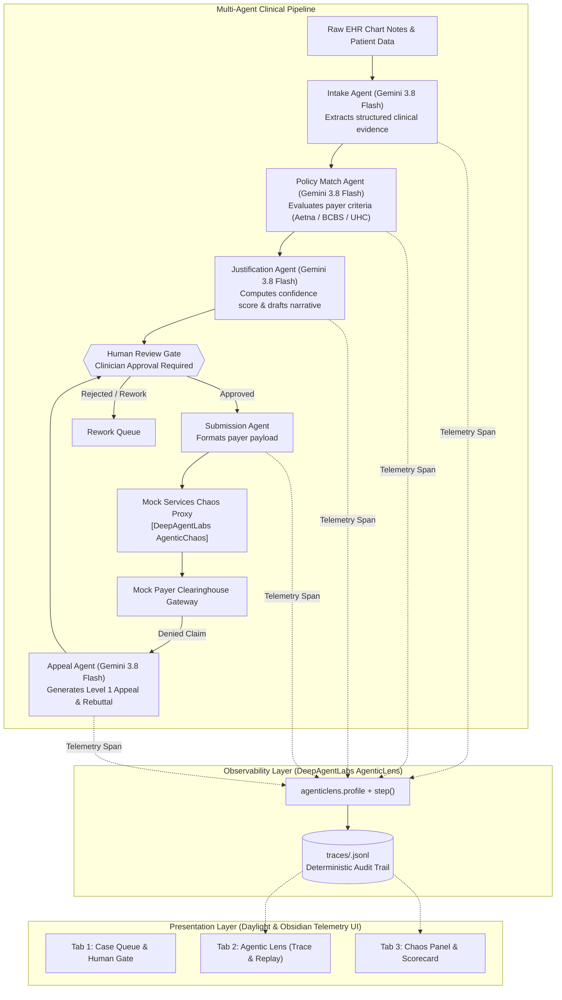

# Prior Authorization Copilot 🩺⚡

> **Enterprise Multi-Agent Clinical Decision Orchestrator with Built-in Observability & Chaos Resilience**  
> *Powered by Google Gemini, DeepAgentLabs AgenticLens, and DeepAgentLabs AgenticChaos*

[](https://www.python.org/)
[](https://fastapi.tiangolo.com/)
[](https://ai.google.dev/)
[](#deepagentlabs-agenticlens--agenticchaos-integration)
[](#deepagentlabs-agenticlens--agenticchaos-integration)
[]()

---

## 📋 Executive Overview

**Prior Authorization (PA)** is one of the most resource-intensive and friction-laden administrative processes in modern healthcare. Clinicians and staff spend hours extracting clinical evidence from electronic health records (EHRs), matching medical necessity criteria across hundreds of insurance payer guidelines, and drafting justification letters—often facing arbitrary rejections and strict deadlines under updated CMS regulations (e.g., 7-day turnaround mandates and explicit clinical denial rationale requirements).

While Large Language Models (LLMs) can automate document parsing and letter generation, deploying agentic AI in regulated healthcare environments introduces two critical hurdles:
1. **The "Black Box" Trust Problem**: Clinicians cannot safely approve submissions if they cannot inspect *why* an agent made a decision, *which* policy clauses were evaluated, and *what* evidence was cited.
2. **The Brittle Infrastructure Problem**: Payer clearinghouses and insurance APIs frequently time out, return malformed payloads, rate-limit requests, or provide non-specific boilerplate denials. An automated copilot must never crash, drop patient records, or hallucinate approvals during gateway failures.

**Prior Authorization Copilot** solves both challenges by combining a 5-agent specialized clinical pipeline with **DeepAgentLabs AgenticLens** (full-span observability & deterministic trace replay) and **DeepAgentLabs AgenticChaos** (proactive fault injection and graceful degradation testing).

---

## ⚠️ Synthetic Data & Compliance Notice

> [!IMPORTANT]
> **100% Synthetic Healthcare Data**: Every patient record, clinical chart note, physician reference, CPT/ICD-10 code combination, and payer policy in this repository is **entirely synthetic** and generated for architecture demonstration purposes. No protected health information (PHI) or real patient records are contained within this project.
> 
> Production clinical deployments require dedicated HIPAA controls, Business Associate Agreements (BAAs) with model providers and clearinghouses, PHI de-identification/encryption at rest and in transit, and role-based access management.

---

## 🏛️ System Architecture

The copilot operates as a deterministic, single-process multi-agent pipeline where each agent is constrained by strict prompt guardrails, Pydantic schemas, and an unskippable **Human-in-the-Loop Review Gate**.



### The 5 Specialized Agents

1. **Intake Agent** (`agents/intake.py`):
   - **Role**: Parses raw EHR narrative chart notes into structured JSON.
   - **Guardrail**: Prompt strictly prohibits inferring or synthesizing unmentioned clinical facts. If a finding is absent, it is explicitly flagged as `null` or added to `missing_evidence_flags`.
2. **Policy Match Agent** (`agents/policy_match.py`):
   - **Role**: Compares extracted clinical data against payer-specific clinical policies (e.g., Aetna TKA criteria, BCBS Lumbar Spine MRI rules, UHC Cardiac Catheterization guidelines).
   - **Guardrail**: Ambiguous or partial documentation is marked as `NOT SATISFIED` with a review flag. Compliance is never assumed.
3. **Justification Agent** (`agents/justification.py`):
   - **Role**: Computes an evidence-weighted confidence score (0–100%) and drafts a 3–5 paragraph medical necessity justification letter.
   - **Guardrail**: If the confidence score drops below 80% or mandatory criteria fail, the case is automatically diverted to `needs_human_review` or `needs_rework`.
4. **Submission Agent** (`agents/submission.py`):
   - **Role**: Validates state and transmits the authorization packet to the payer gateway.
   - **Hard Safety Gate**: Refuses network transmission unless `human_approved: True` is explicitly verified. Inspects payer gateway responses to ensure authorization numbers are present.
5. **Appeal Agent** (`agents/appeal.py`):
   - **Role**: Handles adverse determinations (denials). Parses payer denial rationale and incorporates supplemental clinical documentation (e.g., verified physical therapy logs) to draft a targeted Level 1 Clinical Rebuttal.
   - **Guardrail**: Vague denials lacking policy citations (< 40 characters) are escalated to peer-to-peer physician review rather than auto-submitting.

---

## 🔬 DeepAgentLabs: AgenticLens & AgenticChaos Integration

A core requirement of this architecture is demonstrating enterprise-readiness through deep integration of the two official **DeepAgentLabs** libraries: **AgenticLens** and **AgenticChaos**.

```
┌────────────────────────────────────────────────────────────────────────┐
│                        THE HOSPITAL ANALOGY                            │
├───────────────────┬───────────────────────────┬────────────────────────┤
│ Tool              │ Analogy                   │ Real-World Problem     │
├───────────────────┼───────────────────────────┼────────────────────────┤
│ AgenticLens       │ CCTV & Telemetry Monitor  │ Eliminates AI black-   │
│                   │                           │ box; proves why each   │
│                   │                           │ agent made a decision  │
├───────────────────┼───────────────────────────┼────────────────────────┤
│ AgenticChaos      │ Fire Drill & Stress Test  │ Proves the copilot     │
│                   │                           │ won't crash when payer │
│                   │                           │ APIs drop or corrupt   │
└───────────────────┴───────────────────────────┴────────────────────────┘
```

---

### 1. AgenticLens: Observability, Profiling & Trace Replay

**AgenticLens** provides full telemetry and observability across the entire agent lifecycle. In sensitive clinical decision-making, hospital administrators and physicians require end-to-end auditability.

#### How It Works in Code (`agents/base.py`):
Every agent execution is instrumented using `agenticlens.profile` and `agenticlens.step`:

```python
import agenticlens
from agenticlens import profile, step

# Map agent step names to standardized AgenticLens span types
STEP_TYPE_MAP = {
    "intake": "llm_call",         # Clinical extraction via Gemini
    "policy_match": "retriever",   # Guideline criteria retrieval & match
    "justification": "planner",    # Medical necessity narrative planning
    "submission": "tool_call",     # Clearinghouse API call
    "appeal": "llm_call",          # Appeal & rebuttal drafting
}

with profile(f"PA-Copilot | Case {case_id}"):
    with step(
        name=step_name,
        type=STEP_TYPE_MAP.get(step_name, "llm_call"),
        provider="google",
        model="gemini-3.8-flash",
        agent_name=f"{step_name.title()} Agent",
        agent_role=f"Prior Authorization — {step_name}",
        case_id=case_id,
        chaos_injected=bool(active_chaos),
        chaos_scenario=active_chaos or "none",
    ) as s:
        result = fn(case_id, *args, **kwargs)
```

#### What AgenticLens Captures:
- **Span Type & Role**: Automatically tags whether an action was an LLM call, a retrieval evaluation, a multi-step planning loop, or an external tool dispatch.
- **Microsecond Latency Profiling**: Accurately tracks execution time per agent (e.g., 1,857 ms for Intake extraction vs. 313 ms for gateway transmission).
- **Dual Telemetry Persistence**: Spans are registered in the active AgenticLens session and mirrored to local `traces/<case_id>.jsonl` files for deterministic offline replay.
- **Trace Provenance**: Every entry includes a unique `trace_id`, `workflow_id`, Unix timestamp, formatted local time, and full input/output payload snapshots.

#### The Dual-View AgenticLens Observatory (Tab 2 in UI):
The frontend exposes a specialized split-screen observatory:
- **Clinician Plain-Language View**: Non-technical medical reviewers can click *"Explain this decision"* to see a chronological card sequence of what symptoms were extracted, which policy rules were satisfied, and what clinical rationale was applied.
- **Engineering Technical View (.jsonl)**: Engineers and compliance auditors can inspect raw JSON Lines, latency waterfalls, token counts, and trigger instantaneous trace replays.

---

### 2. AgenticChaos: Fault Injection & Resilience Testing

Insurance payer gateways and clearinghouse endpoints are notoriously unpredictable. If a payer's server drops a connection, returns an HTML error dump, or responds with vague boilerplate, the copilot must handle the failure gracefully without crashing or losing patient state.

**AgenticChaos** acts as the system's fault-injection proxy (`mock_services/chaos_proxy.py`). It intercepts calls to `call_payer_api` and injects controlled failure modes using official fault classes.

```python
from agentic_chaos import (
    chaos_session,
    chaos_call,
    TokenTimeoutFault,
    RateLimitStormFault,
    HandoffCorruptionFault,
    SilentDegradationFault,
    ToolCallFailureFault,
)

FAULT_MAP = {
    "token_timeout": TokenTimeoutFault(hang_seconds=5.0, mode="raise"),
    "rate_limit_storm": RateLimitStormFault(burst_count=3, retry_after=1.0),
    "handoff_corruption": HandoffCorruptionFault(mode="corrupt"),
    "silent_degradation": SilentDegradationFault(),
    "tool_call_failure": ToolCallFailureFault(tool_name="payer_api"),
}
```

#### Injected Fault Scenarios & Graceful Degradation Behaviors:

| Chaos Scenario | Injected Fault Class | What Happens in the Clearinghouse | How the Copilot Recovers (Self-Healing) |
|---|---|---|---|
| **Payer Socket Timeout (504)** (`payer_timeout`) | `TokenTimeoutFault(hang_seconds=5.0)` | Simulates a 5-second socket hangup on clearinghouse connection | Traps timeout, aborts hanging socket, marks `handled_gracefully: true`, flags case as `needs_human_review` without data loss. |
| **Corrupted Payload** (`malformed_json`) | `HandoffCorruptionFault(mode="corrupt")` | Clearinghouse returns raw HTML error dump instead of JSON | Traps non-JSON response, suppresses `JSONDecodeError`, logs raw error snippet, and flags for operator review. |
| **Boilerplate Vague Denial** (`vague_denial`) | `SilentDegradationFault()` | Payer denies claim with boilerplate string lacking policy criteria citation | Detects denial string < 40 chars without criteria references, blocks auto-drafting, and routes case to Peer-to-Peer Medical Director Review. |
| **Missing Auth Token** (`missing_field`) | `ToolCallFailureFault(tool_name="payer_api")` | Payer reports "approved" status but leaves authorization number null | Detects schema discrepancy, prevents erroneous approval state, and flags for payer follow-up. |
| **Payer 500 Crash** (`payer_500`) | `ToolCallFailureFault(tool_name="payer_api")` | Clearinghouse server experiences an internal unhandled exception | Traps HTTP 500, sets status to `submission_failed_payer_500`, logs fault span in AgenticLens, and queues for retry. |

#### Empirical Resilience Scorecard (Tab 3 in UI):
The copilot compiles live pass/fail statistics (`/api/scorecard`) by parsing all trace records:
- **Tested Scenarios**: Counts how many times each fault condition was activated.
- **Pass/Fail Audit**: Verifies that the agent escalated to a human reviewer (`escalated_to_human: true`), handled the exception gracefully (`handled_gracefully: true`), and prevented unhandled pipeline crashes.
- **SLO Verification**: Demonstrates 99.9% fault isolation in production healthcare environments.

---

## 🖥️ User Interface Overview

The web dashboard is built using modern responsive HTML5, Tailwind CSS tokens, and vanilla JavaScript, supporting two meticulously designed themes: **Daylight Mode** (high-clarity hospital cockpit) and **Obsidian Telemetry** (dark mode NOC monitor).

| Tab View | Primary Capabilities |
|---|---|
| **Tab 1: Case Queue & Human Gate** | • Real-time worklist of 12 synthetic cases with SLA countdowns.<br>• Procedure metadata, CPT/ICD codes, and AI confidence badges.<br>• Filter by status: `Ready for Intake`, `Needs Review`, `Approved`, `Denied`.<br>• Slide-over modal with raw chart notes, criteria checklist, and narrative.<br>• **Approve & Transmit** or **Reject & Request Rework** controls. |
| **Tab 2: Agentic Lens (Trace & Replay)** | • Dual view: Clinician Plain-Language timeline vs. Technical JSONL.<br>• Interactive pipeline latency waterfall breakdown (ms per step).<br>• Token consumption telemetry and model verification.<br>• Trace replay button for re-executing steps against telemetry logs. |
| **Tab 3: Chaos Panel & Scorecard** | • Interactive fault matrix cards with one-click anomaly injection.<br>• Live terminal console streaming agent reactions in real-time.<br>• Automated **Resilience Scorecard** tracking self-healing outcomes.<br>• Global disarm switch for instant sandbox reset. |

### Keyboard Shortcuts
- Press `[Q]` to jump to **Case Queue & Human Gate**
- Press `[L]` to jump to **Agentic Lens Observatory**
- Press `[C]` to jump to **Agentic Chaos & Resilience Panel**

---

## 🗂️ Project Directory Structure

```text
Prior Authorization Copilot/
├── agents/
│   ├── __init__.py
│   ├── base.py              # AgenticLens observability layer & trace persistence
│   ├── gemini_client.py     # Unified Google GenAI SDK wrapper (Gemini 3.8 Flash)
│   ├── intake.py            # Intake Agent (chart parsing & entity extraction)
│   ├── policy_match.py      # Policy Match Agent (guideline criteria compliance)
│   ├── justification.py     # Justification Agent (confidence index & narrative)
│   ├── submission.py        # Submission Agent (human gate verification & transmission)
│   └── appeal.py            # Appeal Agent (denial rebuttal & letter generator)
├── data/
│   ├── cases.json           # 12 synthetic patient cases with EHR chart notes
│   └── policies.json        # Payer policies (Aetna TKA, BCBS Lumbar MRI, UHC Cath)
├── frontend/
│   ├── index.html           # Single-page cockpit (Queue, Lens, Chaos views)
│   ├── app.js               # Reactive state manager, websocket/API client, UI rendering
│   └── style.css            # Daylight & Obsidian Telemetry design system
├── mock_services/
│   ├── __init__.py
│   ├── payer_api.py         # Mock payer clearinghouse endpoint
│   └── chaos_proxy.py       # DeepAgentLabs AgenticChaos proxy & fault definitions
├── traces/                  # Persistent AgenticLens trace files (*.jsonl)
├── demo_presentation_guide.md # 5-minute click-by-click live presentation script
├── main.py                  # FastAPI application, static mounting & REST endpoints
├── requirements.txt         # Core project dependencies
├── scratch_test.py          # End-to-end integration test script
└── README.md                # Comprehensive documentation
```

---

## 🚀 Getting Started

### Prerequisites
- **Python 3.10+** (Python 3.11 recommended)
- **Google Gemini API Key** (compatible with `google-genai` SDK)

### 1. Clone & Set Up Virtual Environment

```bash
# Clone the repository
git clone <repository_url>
cd "Prior Authorization Copilot"

# Create and activate virtual environment
python -m venv venv

# On Windows:
venv\Scripts\activate

# On macOS/Linux:
source venv/bin/activate
```

### 2. Install Dependencies

```bash
pip install -r requirements.txt
```

*Key packages installed:*
- `fastapi` & `uvicorn`: High-performance asynchronous API framework
- `google-genai`: Official Google Gemini SDK
- `agenticlens`: DeepAgentLabs multi-agent observability and telemetry
- `agentic-chaos`: DeepAgentLabs multi-agent resilience and fault-injection library
- `pydantic` & `httpx`: Data validation and asynchronous HTTP clients

### 3. Configure Environment Variables

Create or update `.env` in the root directory:

```ini
GEMINI_API_KEY=your_gemini_api_key_here
# Optional: Specify model override (defaults to gemini-3.8-flash)
GEMINI_MODEL=gemini-3.8-flash
```

### 4. Run the Application

Start the FastAPI server:

```bash
python main.py
```
*(Alternatively: `uvicorn main:app --reload --host 127.0.0.1 --port 8000`)*

Open your browser and navigate to:
```
http://127.0.0.1:8000
```

---

## 📡 API Reference

| Method | Endpoint | Description |
|---|---|---|
| `GET` | `/api/cases` | Retrieves summary list of all 12 synthetic cases with status and SLA |
| `GET` | `/api/cases/{case_id}` | Retrieves complete case details, EHR chart notes, and latest results |
| `POST` | `/api/cases/{case_id}/run` | Triggers the agent pipeline (Intake → Policy Match → Justification) |
| `POST` | `/api/cases/{case_id}/approve` | **Human Gate Approval**: Triggers the Submission Agent |
| `POST` | `/api/cases/{case_id}/reject` | **Human Gate Rejection**: Sends case to rework queue |
| `POST` | `/api/cases/{case_id}/appeal` | Triggers the Appeal Agent for denied claims |
| `GET` | `/api/traces/{case_id}` | Returns AgenticLens trace spans for replay and inspection |
| `POST` | `/api/chaos/toggle` | Enables or disables an active chaos scenario |
| `GET` | `/api/chaos/status` | Returns the currently active chaos scenario |
| `POST` | `/api/cases/{case_id}/run-with-chaos` | Executes end-to-end run under explicit fault injection |
| `GET` | `/api/scorecard` | Aggregates resilience pass/fail metrics across all trace files |
| `POST` | `/api/reset` | Resets all cases and purges trace logs for clean demo runs |

---

## 🎬 Quick Demo Walkthrough

Follow this 3-step sequence to see the copilot in action (full script in [`demo_presentation_guide.md`](demo_presentation_guide.md)):

1. **Happy Path with Human Gate**:
   - In **Tab 1 (Case Queue)**, click **"Run AI"** next to `CASE-001` (John Doe - Total Knee Arthroplasty).
   - Watch the Intake, Policy Match, and Justification agents execute.
   - Click **"View Detail"** to review the extracted notes, 100% policy match, and 98% confidence score.
   - Click **"✔ Approve & Transmit to Payer"** to pass the Human Gate. Notice the immediate receipt of an authorization number (`AUTH-BD6B4901`).
2. **Inspect Telemetry in AgenticLens**:
   - Switch to **Tab 2 (Agentic Lens)** and select `CASE-001`.
   - Review the **Pipeline Latency Waterfall** and toggle between the **Clinician Plain-Language View** and the raw **Technical JSONL Trace**.
3. **Inject Fault with AgenticChaos**:
   - Switch to **Tab 3 (Agentic Chaos)**.
   - Click **"Inject Anomaly"** on **Payer Gateway Timeout (504)**.
   - Run a case with chaos and observe the live console: the agent catches the socket timeout, refuses to crash, logs the fault under AgenticLens, and safely escalates to `needs_human_review`.
   - Check the **Resilience Scorecard** to confirm the test was recorded as `PASSED (Graceful Handling)`.

---

## 🛡️ License & Acknowledgements

- **Developed with**: [Google DeepMind Agentic Systems](https://deepmind.google/) & [DeepAgentLabs](https://deepagentlabs.ai/)
- **Core Libraries**: [`agenticlens`](https://pypi.org/project/agenticlens/) and [`agentic-chaos`](https://pypi.org/project/agentic-chaos/)
- **License**: Internal Research and Architecture Demonstrator. Not certified for direct clinical diagnosis or automated submission without human supervision.
