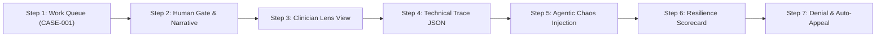

# Prior Authorization Copilot — Live Demo Script & Presenter Guide

> **Target Presentation Time:** 4 to 5 Minutes  
> **Key Architecture Pillars to Highlight:** **Agentic Lens** *(Observability & Replay)* + **Agentic Chaos** *(Resilience & Fault Testing)*

---

## 1. Compliance Disclaimer (Say this BEFORE any demo)

> *"Before we begin, please note that all patient records, chart notes, and payer policies used in this system are **100% synthetic**. This presentation demonstrates the design patterns — decision traceability and resilience testing for agentic systems in a regulated domain — rather than a certified production clinical tool. A real deployment would require HIPAA controls, PHI encryption, and payer BAAs before touching live patient data."*

---

## 2. The 30-Second Pitch (Context & Problem)

> *"Prior authorization is one of the most hated, time-consuming workflows in healthcare. Under recent CMS mandates, payers must render decisions within 7 days and provide explicit clinical denial reasons rather than boilerplate text."*
> 
> *"Automating prior authorization with LLM agents is the easy part. **The hard part is trust and resilience**: Can a clinician verify exactly WHY an agent made a recommendation? And can the system survive when a payer API times out or sends corrupted data?"*
> 
> *"That is what this copilot demonstrates: **Every decision is 100% traceable, and every failure mode is stress-tested, not hoped away.**"*

---

## 3. Step-by-Step Demo Sequence (Click-by-Click)

---

### Step 1: Work Queue & AI Pipeline Execution
- **Where to click:** Open [http://127.0.0.1:8000](http://127.0.0.1:8000) on **Tab 1 (Case Queue & Human Gate)**.
- **Action:** Click **"Execute All Pending Pipelines"** or click **"Run AI"** next to **`CASE-001` (John Doe)**.
- **What to explain out loud:**
  - *"Here is our active Prior Auth Work Queue. Each case tracks requested procedure, payer policy, SLA deadline countdown, and AI confidence score."*
  - *"When we run `CASE-001`, the system fires our Intake Agent to parse raw chart notes, the Policy Match Agent to evaluate against Aetna's TKA criteria, and the Justification Agent to compute a confidence index (95%) and generate a structured medical necessity statement."*

---

### Step 2: Human-in-the-Loop Review & Gate
- **Where to click:** Click **"View Detail"** on `CASE-001`.
- **Action:** Point out the extracted Clinical Chart Notes, Policy Compliance Checklist (all green checks), and AI Justification Narrative. Click **"✔ Approve & Transmit to Payer"**.
- **What to explain out loud:**
  - *"Notice our core safety guardrail: **No network payload is transmitted to a payer API without explicit Human Gate approval.**"*
  - *"The clinician reviews the policy clause alignment and narrative, then clicks Approve. The Submission Agent formats the request, transmits it to the Payer Clearinghouse, and instantly receives an authorization number (`AUTH-XXXXXX`)."*

---

### Step 3: Agentic Lens — Clinician Plain-Language View
- **Where to click:** Switch to **Tab 2: Agentic Lens (Trace & Replay)**. Select **`CASE-001`** in the dropdown. Ensure **Clinician View** is selected.
- **Action:** Scroll through the timeline cards (Intake -> Policy Match -> Justification -> Submission).
- **What to explain out loud:**
  - *"This is our **Agentic Lens**. To build clinical trust, clinicians can click 'Explain this decision' to inspect a plain-language audit trail of every agent step."*
  - *"It shows exactly what symptoms were extracted, which policy clauses passed, the latency per step, and the exact decision rationale—eliminating the 'black box' problem of AI."*

---

### Step 4: Agentic Lens — Technical Trace & Audit JSON
- **Where to click:** Click the toggle **"Technical Trace JSON View"** in Tab 2.
- **Action:** Show the raw JSON Lines stream and latency bar breakdown.
- **What to explain out loud:**
  - *"For engineering and compliance teams, every agent execution is appended to a structured JSON Lines trace file (`traces/CASE-001.jsonl`). This allows full deterministic replay, latency profiling, and audit compliance logging."*

---

### Step 5: Agentic Chaos & Resilience Panel (Fault Injection)
- **Where to click:** Switch to **Tab 3: Agentic Chaos & Resilience Panel**.
- **Action:** Click **"Inject & Test"** under **Payer Gateway Timeout (504)** or **Corrupted Non-JSON Payload**.
- **What to explain out loud:**
  - *"Now let me show you our second pillar: **Agentic Chaos**. In real-world healthcare IT, payer APIs fail, time out, or send corrupted responses."*
  - *"Instead of crashing or silently swallowing errors, our Chaos Proxy injects realistic production failure modes to test agent resilience."*
- **Observe:** Point to the Live Chaos Trace Console in real-time:
  - *"Watch the live console log: When the 504 Timeout hits, our Submission Agent gracefully catches the exception, marks `handled_gracefully: true`, tags `chaos_injected: true`, and safely escalates the case to `needs_human_review`."*

---

### Step 6: Empirical Resilience Scorecard
- **Where to click:** Highlight the **Agentic Resilience Scorecard** table on Tab 3.
- **What to explain out loud:**
  - *"Our system automatically compiles an empirical **Resilience Scorecard**. It logs how many fault scenarios were tested, expected recovery behavior vs. actual outcome, and verifies that no unhandled exceptions broke the pipeline."*

---

### Step 7: Denial Parsing & Targeted Clinical Appeal
- **Where to click:** Return to **Tab 1 (Case Queue)**. Select **`CASE-006` (Sarah Connor)** which is in `denied` status.
- **Action:** Click **"Draft Level 1 Clinical Appeal"** (or click View Detail -> Draft Appeal).
- **What to explain out loud:**
  - *"Finally, when a payer denies a request—such as `CASE-006`, which was denied due to missing Physical Therapy records—our **Appeal Agent** parses the specific denial clause, scans newly attached PT attendance logs, and auto-drafts a targeted, evidence-backed Level 1 Appeal letter ready for physician signature."*

---

## 4. Key Q&A & Talking Points

| Expected Question | Best Recommended Answer |
|---|---|
| **Q: What LLM models power the agents?** | *"The architecture uses scoped, low-temperature prompt templates with structured Pydantic JSON schema enforcement to ensure deterministic output and prevent hallucinations."* |
| **Q: What happens if a payer API stays down indefinitely?** | *"The agent pipeline catches the gateway error, persists state to the trace log, and queues the case for manual portal upload or scheduled exponential backoff retry."* |
| **Q: How does this comply with CMS 7-day SLA rules?** | *"The dashboard automatically highlights cases with < 12 hours remaining on SLA deadlines in urgent red, prioritizing them for human review."* |

---

## 5. Demo Emergency Fallback Plan
- If you want to reset everything back to clean state during or after a demo run:
  - Click the red **"Reset State"** button in the top header.
  - This resets all 6 synthetic cases and clears trace files instantly.
